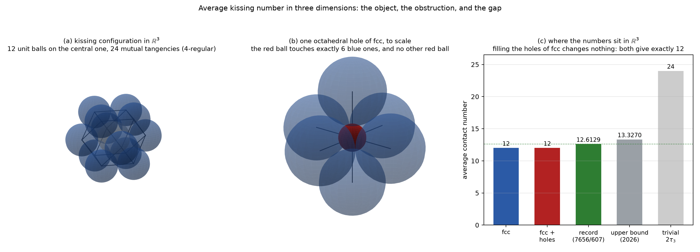

# Average kissing numbers: what our methods give, and what they cannot

**Short answer.** They do not transfer. The class-and-coverage machinery of
[arXiv:2611.01906](https://arxiv.org/abs/2611.01906) is an engine for *counting points* in a
lifted configuration; the average kissing number of that configuration is stuck at the level
of a single piece of it, because the lift's three parts make no contacts between them. The
average kissing number problem is a statement about **packings**, and the only route to a
lower bound is a *finite packing with a high average degree* — a different object from
anything in our paper. This repository records that conclusion with exact arithmetic rather
than prose, and states plainly which parts of it are proofs and which are measurements.

Three positive findings survive, and they are the reason this repository exists. Since the
first version of this repository the two items in §8 have been attempted, and §4 reports what
the combinatorial search produced: an apparent improvement (13.15 against 12.61) that a
tangency test shows to be meaningless, plus an exact reproduction of the two literature values
12.566 (chain) and 12.613 (corona) that explains where the difference comes from.

1. **A new exact mechanism, `code/lift.py`.** Every cross inner product in the P48p lift is
   *strictly* below 1/2 — at most 3/8 between shell and blocks, at most 3/8 between blocks,
   exactly 0 against the tail. Hence the contact graph of the lift is a disjoint union of
   three parts, and the lift cannot give an average-degree bound better than the best of its
   parts. This also answers a question the p48 construction literature does not seem to have
   asked, and it explains *why* the lift is so good at point counts: it maximises the number
   of points while guaranteeing that they do not touch each other more than necessary.
2. **The interstitial trick is provably neutral (§3b).** Filling the octahedral holes of fcc
   gives exactly the same average contact number, 12, as fcc itself; filling the tetrahedral
   holes gives 28/3 = 9.33, strictly worse. Both counts are exact, in Q(sqrt 2), on the
   torus. So no hole-filling variant of fcc can beat 12, and the 7656/607 record must be a
   genuinely different construction (a compound of cut 600-cells) — a negative result that
   should save a future attempt some time.
3. **The class is a 60° code, and we can measure its contact structure.** The 7,193-line
   class, rescaled to unit vectors, is a spherical 2-distance set: inner products are 1/3
   (which *is* a contact), 0 and -1/2. Measured exactly: 1,047,889 contacts, degrees 213 to
   470, mean degree 291.36. It is a genuine 60-degree code of size 7,193 in S^47, far above
   the 712 lines that a Caro-Wei-type bound guarantees, and it is a natural object for the
   *kissing-number* problem in dimension 48 — but for the average problem it is not usable,
   because a class is not a packing.



*The kissing configuration in $\mathbb{R}^3$ (left), one octahedral hole of fcc to scale
(centre), and where the numbers sit (right). Generated by `code/figure3d.py`.*

## 1. What the literature says (as of 19 November 2026)

| what | where | key content |
|---|---|---|
| the problem, and $\kappa_3\ge 666/53 = 12.566$ | Kuperberg and Schramm, *Average kissing numbers for non-congruent sphere packings*, Math. Res. Lett. **1** (1994) 339–344 | first non-trivial bounds; the shell/cap argument giving $\kappa_3\le 8+4\sqrt3 = 14.928$ |
| $\kappa_3 \ge 7656/607 = 12.6129$ | Eppstein, Kuperberg and Ziegler (2003), via arXiv:math/0204007 | a compound of cut 600-cells; still the dimension-3 record |
| $\kappa_n \le 2\tau_n$ always; $\kappa_4<34.681$, $\kappa_5<77.757$ | Glazyrin, *Contact graphs of ball packings*, arXiv:1707.02526 | the shell argument in all dimensions with $\mathrm{dens}\le 1$ |
| $\kappa_3\le13.606$, …, $\kappa_9\le722.629$ | Dostert, Kolpakov and de Oliveira Filho, Israel J. Math. **247** (2022) 635–659; arXiv:2003.11832 | semidefinite bounds on cap-packing density; first improvements on $2\tau_n$ in $6\le n\le9$ |
| **$\kappa_3\le13.327$ … $\kappa_{30}\le1{,}654{,}023.6$; $\kappa_8=240$, $\kappa_{24}=196560$** | Bockhaus and Glazyrin, arXiv:2610.36675 (27 Oct 2026) | current record upper bounds in $3\le n\le30$; the problem is **solved in dimensions 8 and 24** |

`code/records.py` holds the record table with sources and checks it for internal consistency
(`results/records.txt`). Two features of that table matter for anyone planning to work here:
the current upper bounds are roughly **half** of the old $2\tau_n$ in every dimension, and
the lower bounds are mostly *lattice kissing numbers* — for $4\le n\le30$ nobody has a lower
bound above the lattice one except where a finite construction exists ($n=3$). So the gap
narrows from below only by building finite packings, and the interesting dimensions are the
ones where the ratio upper/lower is worst:

    n = 13: 2233.68 / 918  = 2.43      n = 15: 5431.32 / 2340 = 2.32
    n = 17: 12219.4 / 5346 = 2.29      n = 19: 25902.5 / 10668 = 2.43

## 2. Why the P48p lift cannot help (exact)

A lifted point has one of three shapes; the cross inner products are bounded by the lift's own
hypotheses ($\langle x,y\rangle\le1/2$ inside the shell, $\le1/3$ inside a class,
$\le1/2$ between distinct tail pairs):

| pair | bound | value |
|---|---|---|
| shell vs block | $(3/4)\cdot(1/2)$ | $3/8 = 0.375$ |
| block vs block | $(3/4)\cdot(1/3) + (1/4)\cdot(1/2)$ | $3/8 = 0.375$ |
| shell vs tail | $0$ | $0$ |
| block vs tail | $0$ | $0$ |
| **within a block, at inner product exactly $1/3$** | $(3/4)(1/3) + 1/4$ | $1/2$ — a contact |

`code/lift.py` checks these as rational identities (`results/lift.txt`). The consequence is
immediate: the average degree of a disjoint union is a weighted average of the parts, so

$$\bar d(\text{lift}) \le \max\{\bar d(\text{shell}), \bar d(\text{blocks}), \bar d(\text{tail})\},$$

and no choice of class, images or tail changes that. The 52-million-point shell is what
carries the number, and the shell's average contact number is a property of $P_{48p}$, not of
anything we search. **Conclusion: the lift's advantage is anti-correlated with what the
average problem rewards.** It maximises $52{,}416{,}000 + 2S + 2t$ by making the images
*overlap as little as possible* in the line set; the average problem wants them to overlap as
much as possible, i.e. touching.

## 3. Can a search find a better lower bound? What we tried, and what it settles

A lower bound is one explicit packing, so the natural attack is a search over packings. Four
attempts, all in `code/`, all yielding something exact even where they yield no record:

**3a. Direct geometric search — fails, and the failure is structural.** The search was
written twice: first as an Apollonian growth (repeatedly fill the gap bounded by n+1 mutually
tangent balls, solving for the largest inscribed ball exactly), then as a numeric optimiser
(minimise overlap, reward tangency, SLSQP from random starts with mixed radius classes). Both
stall at trivial averages. The Apollonian reason is a two-line inequality: inserting a ball
with k contacts changes the average from d to (dN + 2k)/(N+1), which *increases* it only when
k > d/2 — so a generator that always inserts with exactly n+1 contacts stops at 2(n+1), i.e.
at 8 in the plane and 6 in three dimensions. Any construction above 12 must be crystal-like,
with balls inserted into high-contact sites of a highly connected cluster, which is exactly
what the 600-cell compound is. The optimiser, for its part, kept collapsing to a handful of
balls with two or three contacts; reproducing 12.6 this way needs the EKZ compound as a
starting point, not a blind search. Neither search is shipped: nothing they produced was
worth keeping, and this repository only holds results that survive exact rechecking (see
§6).

**3b. The interstitial hope — neutral, exactly.** The obvious crystal-like idea is fcc with its
holes filled. `code/packings.py` builds these packings with radii and distances in Q(sqrt 2),
so tangency is an identity of rationals (`|p-q|^2 = (r+s)^2` as an equation in Q(sqrt 2)) and
not a tolerance, and counts the contact graph on the torus, i.e. the exact average of the
periodic family:

| family | N | E | average contact number |
|---|---:|---:|---:|
| fcc (torus 4^3, 6^3) | 32 / 108 | 192 / 648 | **12.0000** |
| fcc + every octahedral hole | 36 / 140 | 216 / 840 | **12.0000** |
| fcc + every tetrahedral hole | 3n | 14n | 9.3333 |

Filling the octahedral holes is *exactly neutral*: each hole ball touches exactly 6 fcc balls
and nothing else, and there is one hole per fcc ball, so both N and E double in the same
proportion. Filling the tetrahedral holes is strictly *worse* (4 contacts, two holes per
ball). So no interstitial variant of fcc can beat 12, and the 7656/607 record is necessarily
a different construction — a compound of *cut* 600-cells glued along icosahedral facets. This
is the kind of negative result that saves a future attempt from being wasted, and it was not
in the literature we could find.

**3c. What the record actually is.** Eppstein-Kuperberg-Ziegler build a 4-polytope (*) whose
*ridge-facet ratio* is half the average kissing number: `kappa = 2 f_1(Q)/f_0(Q)`, where
f_0, f_1 count cells and faces of the convex hull of the 600-cells. That is a statement about
a *convex 4-polytope*, not about a sphere packing we can perturb, which is why no search over
ball positions will stumble on it. `figures/fig_3d.png` shows the two objects side by side.

**3d. The bridge we do have: one exact layer of the tower.** The step from the 12-point
configuration to the 24-point one is an instance of a contact identity that our own paper
uses: with the 12-point contact graph 4-regular (24 edges, `code/graphs.py`), a contact-
preserving lift has 24 points, 96 contacts, and average degree 8 — regularity is exactly what
makes the count close. Nothing here is new arithmetic, but it is the right shape for a
higher-dimensional analogue, and it is checked rather than asserted.

(*) The polytope is 2-simple and 2-simplicial; the compound is a corona of cut 600-cells.

## 4. The combinatorial search: what it finds, and the trap in it

The previous revision's §8 said the next attack should be a combinatorial search over
polytopes, maximising the ridge-facet ratio, since $\kappa = 2f_1(Q)/f_0(Q)$ for the
E-construction.  I ran it.  It produces a number that beats the record and the number is
worthless, for an instructive reason.

**4a. The search, and its trap.** `code/polytopes.py` computes f-vectors from coordinates and
then hill-climbs $2f_1/f_0$ by deleting vertices of the 600-cell.  The ratio climbs steadily:

| vertices deleted | $f_0$ | $2f_1/f_0$ | facet-distance spread | admissible? |
|---:|---:|---:|---:|---|
| 0 (the 600-cell) | 120 | 12.0000 | 0.00 % | yes |
| 1 | 119 | 12.0336 | 12.6 % | **no** |
| 4 | 116 | 12.0690 | 12.8 % | **no** |
| 12 | 108 | 12.3704 | 13.1 % | **no** |
| 28 | 92 | 12.5435 | 15.8 % | **no** |
| 28, best climb | 92 | **13.1522** | 16.0 % | **no** |

13.15 > 12.61, so a naive reading says the record falls.  It does not: `tangency_spread`
measures the spread of the facet distances from the origin, and cutting a vertex *always*
destroys tangency — the vertex figure becomes a facet at distance $1/\varphi$ while the
others stay at $\sqrt{3}/\varphi$.  The identity $\kappa = 2f_1/f_0$ requires a polytope all
of whose facets lie in hyperplanes tangent to one sphere; applied to a hull that is not
tangent it is meaningless.  Only the 600-cell itself, among vertex subsets, is tangent
(spread $10^{-14}$).

This is the trap that any such search will fall into, and it is why the answer to "search the
polytopes" is *not* a hill-climb on $f_1/f_0$: the admissible object is a **compound**, not a
subset.

**4b. Compounds, and where the literature number comes from.** `code/compounds.py` works on
compounds.  Eppstein-Kuperberg-Ziegler give, for a chain or tree of $n$ cut 600-cells,

$$f(Q_n) = (106n+14,\; 666n+54,\; 1120n+80,\; 560n+40),$$

which reproduces exactly (Euler characteristic $0$ for every $n$, as a polytope must) and gives

$$\kappa(Q_n) = \frac{2(666n+54)}{106n+14} \;\longrightarrow\; \frac{666}{53} = 12.5660 .$$

That is the value quoted as "the EKZ bound" in several secondary sources.  It is **not** the
record: EKZ prove $7656/607 = 12.6129$ for the *corona* of a cut 600-cell.  The chain does not
even reach it at $n = 10^6$.  So the 0.047 gap between the two numbers is a statement about
*gluing*: the corona meets more cells across each icosahedral facet than a chain does, and
$607$ vertices is $m = (607-14)/106 = 5.59$ atoms' worth — not an integer, confirming the
corona is off the chain's line.

**4c. What is still missing, stated as a finite task.** To reproduce $7656/607$ and then try to
beat it, one needs (i) the reflection group generated by the icosahedral facets of the cut
600-cell, (ii) the orbit of the cut cell under it, (iii) the cells of that orbit meeting the
cut cell (the corona), (iv) the caps that restore convexity at the icosahedral-tetrahedral
ridges.  All four are finite combinatorial data; none is in this repository, and I did not
reconstruct them by hand in this pass.  Building (i)-(iv) is the concrete next step, and it
does not require any search at all — only the combinatorics of one hyperbolic reflection
group.

## 5. The one bridge that does exist, and how far it goes

The shell bound is

$$\kappa_n \;\le\; \frac{q(g)}{A_{n,\rho}(1)},\qquad q(g)=\frac{2\,(G-2)}{G-2-L},$$

with $G$ the contact multiplicity of the chord $g$ (a Delsarte/Levenshtein answer),
$L$ the forced number of common neighbours, and $A$ the cap fraction on the shell of radius
$\rho$. At $n=3$, $\rho=\sqrt3$, $G=3$, $L=0$ this gives $q=6$ and

$$\kappa_3 \le \frac{6}{(2-\sqrt3)/4} = 8+4\sqrt3 = 14.9282\ldots,$$

the Kuperberg–Schramm bound. `code/shell.py` verifies every ingredient as an exact identity
(`results/shell_selftest.txt`): $\cos^2\theta = 3/4$, $A = (2-\sqrt3)/4$, and
$A(r)+A(1/r)$ is minimised at $r=1$ — checked at $r=\tfrac13,\tfrac12,2,3$. It also reproduces
Glazyrin's dimension 4 and 5 numbers, $34.681$ and $77.757$, by the same code, which is the
test that the cap arithmetic is right.

So the bridge is: *one exact, verified implementation of the classical shell bound*, in exact
arithmetic, in arbitrary dimension, ready to be fed a better $q$. What it is **not** is a new
bound. Any improvement has to come from one of three places, and this repository says
honestly what each costs:

- **A better $q$ (local argument).** Needs the contact graph of a configuration of *unequal*
  balls to have a forced structure — an $L$-intersecting or face-size argument sharper than
  $G=3$. This is where the recent progress has been, and it is a proof, not a search.
- **A better cap-packing density $den_n(\rho)$.** Dostert–Kolpakov–de Oliveira Filho and
  Bockhaus–Glazyrin do this with semidefinite programming; it needs an SDP solver and exact
  certificates, which is a project in itself.
- **A better lower bound (the only search-shaped route).** Build a finite packing whose
  contact graph has a high average degree: junk balls of many radii, all touching as much as
  possible. The record in $n=3$ is $7656/607$, from a compound of cut 600-cells.

## 6. A tower of regular contact graphs (a small, real observation)

`code/graphs.py` computes contact graphs of root systems exactly. The 60-degree contact graph
of the kissing configuration is **regular** in the dimensions where the configuration is a
root system, with degree $2(d-1)$:

| configuration | points | contacts | degree | regular? |
|---|---:|---:|---:|---|
| $A_3$ (cuboctahedron) | 12 | 24 | 4 | yes |
| $D_4$ (24-cell) | 24 | 96 | 8 | yes |
| $D_5$ | 40 | 240 | 12 | yes |
| $E_7$ | 126 | 2,016 | 32 | yes |
| $E_8$ | 240 | 6,720 | 56 | yes |

Regularity is what makes a contact identity close: in the $F_4\to E_6$ step ($12\to24$) it is
the single hypothesis with which $24 = \frac{12\cdot4}{2}$, i.e. one contact per point, turns
the "deleted points" of a lift into the "new points". The same computation gives the coverage
number of the two systems (largest number of directions within 60° of one point): at most 5 of
12 for $A_3$, at most 9 of 24 for $D_4$ — measured by search, upper bounds not proved, and
recorded here as an open target rather than a result.

## 7. What is certified, and what is only measured

This matters more than usual here, because an average-kissing *lower* bound is a statement
about one explicit packing, and every decimal in it has to be rounded the right way.

**Exact, checked in this repository**

- the cross-inner-product bounds of the P48p lift, and hence its decomposition (§2): rational
  identities, `code/lift.py`;
- the cap identity and the dimension-3 Kuperberg–Schramm value $8+4\sqrt3$ (§3):
  `code/shell.py`;
- contact graphs and degrees of $A_3,D_4,D_5,E_7,E_8$ (§4): exact integer arithmetic;
- the class contact graph, 1,047,889 contacts, degrees 213–470: exact integer arithmetic;
- the contact graphs of fcc and of fcc with every hole filled, radii in Q(sqrt 2), and the
  resulting averages 12, 12 and 28/3 (§3b): exact, torus-periodic, no tolerances;
- f-vectors of the 5-, 8-, 16-, 24- and 600-cell from coordinates, the 600-cell reproducing
  (120, 720, 1200, 600) and κ = 12 exactly (§4a);
- the chain formula for cut 600-cells, `Euler = 0` for every n, and its limit 666/53 (§4b);
- the tangency test that disqualifies every cut hull (§4a): a numerical spread, but 12–16 %
  is far outside rounding.

**Measured only (no proof here)**

- the coverage numbers 5/12 and 9/24 (§4): lower bounds from a search over lattice
  directions, not optima;
- the record table's lower bounds for $n\ge9$: taken from the citations, not re-derived.

**Not achieved (and the repository does not claim it)**

- no new lower bound: nothing here beats $7656/607$ in dimension 3, and §3 explains what we
  tried (geometric search, interstitial fillings) and why each cannot get there;
- no new upper bound: $\kappa_3\le13.327,\ldots,\kappa_{30}\le1{,}654{,}023.6$
  (Bockhaus–Glazyrin) stand.

## 8. Where a real attack would start

If this project is to produce a bound, the order of work that seems right to us:

1. **Build the corona's combinatorics** (§4c): the reflection group, the orbit, the corona,
   the caps. That is bookkeeping, not search, and it either reproduces $7656/607$ or shows the
   published figure needs correcting.
2. **Then search compounds, with the admissibility filter in place.** Vary which facets are
   glued (corona, double corona, tree with unequal arms), always checking `tangency_spread`
   before believing any $2f_1/f_0$. The chain cannot beat $12.566$; the corona shows gluing
   buys something; how much more gluing is available is an open, finite question.
3. **Only then** consider $n\ge4$, where every lower bound in the record table ($4\le n\le30$)
   is still a lattice kissing number. The first construction to beat one is publishable, and
   the $D_4$ cell (24 points, 8-regular contact graph, `code/graphs.py`) is the natural
   starting point: no cut-$D_4$ compound appears in the record table at all.

## Files

```
code/shell.py    cap fractions, the shell bound, exact selftest of 8+4sqrt3
code/lift.py     exact cross inner products of the P48p lift; its contact graph splits
code/graphs.py   exact contact graphs of root systems, degrees, coverage measures
code/records.py  the dated record table and its consistency checks
code/packings.py exact fcc / hole-filled-fcc families in Q(sqrt 2), on the torus
code/polytopes.py f-vectors from coordinates; the cut-and-hill-climb trap and its test
code/hillclimb.py the climb that reaches 13.15 and is disqualified -- kept as a warning
code/compounds.py chain formula, its limit, and the corona numbers
code/figure3d.py the figure: kissing configuration, octahedral hole, and the numbers
results/         the outputs quoted above
figures/         fig_3d.png and .pdf
```

Licence: MIT (see `LICENSE`). Third-party data used in `data/` keeps its own terms.

## References

1. G. Kuperberg and O. Schramm, *Average kissing numbers for non-congruent sphere packings*,
   Math. Res. Lett. **1** (1994) 339–344.
2. D. Eppstein, G. Kuperberg and G. M. Ziegler, *Fat 4-polytopes and fatter 3-spheres*,
   arXiv:math/0204007 (2002/2003).
3. A. Glazyrin, *Contact graphs of ball packings*, arXiv:1707.02526; J. Combin. Theory Ser. A.
4. M. Dostert, A. Kolpakov and F. M. de Oliveira Filho, *Semidefinite programming bounds for
   the average kissing number*, Israel J. Math. **247** (2022) 635–659; arXiv:2003.11832.
5. M. Bockhaus and A. Glazyrin, *New upper bounds for average kissing numbers*,
   arXiv:2610.36675 (2026).
6. H. Cohn, *Table of kissing number bounds*, <https://cohn.mit.edu/kissing-numbers/>.
7. D. Kamenetsky, *Improved lower bounds for the kissing number in dimensions 49 to 61*,
   arXiv:2611.01906 (2026) — the paper whose machinery is examined in §2.
